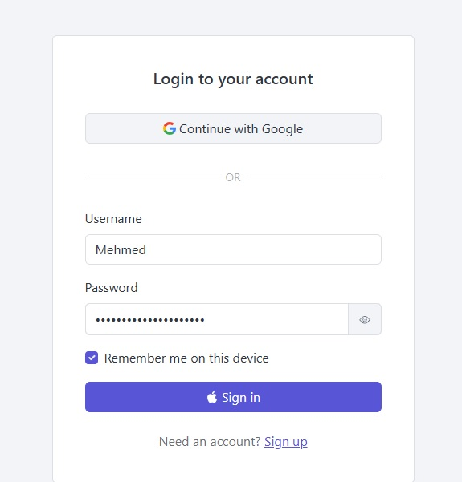
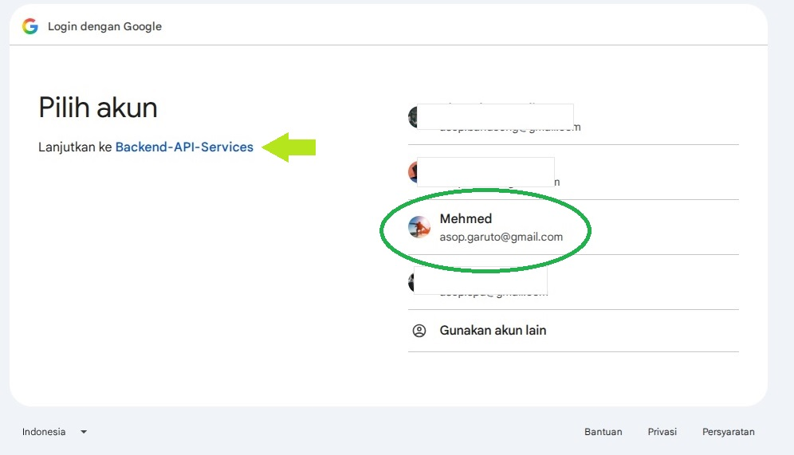
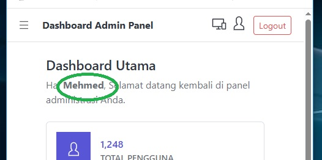

# 🚀 Implementasi JSON Web Token & Google Auth(OAuth 2.0) & EF Core(ORM)

<p align="center">
  
</p>

<p align="center">
  
</p>

<p align="center">
  
</p>


# 🔵 JSON Web Token (Frontend)
adalah sebuah standar industri berbentuk string teks acak yang digunakan untuk mengirimkan informasi secara aman antara dua pihak.
Dalam pengembangan web modern (.NET Core, React, CoreUI), JWT paling sering digunakan untuk sistem autentikasi (login)

Login -> Dapat Tiket -> Akses Fitur

Agar aplikasi browser frontend bisa melakukan login dengan sukses, aplikasi harus memberi tahu server backend untuk memberikan "surat izin" (Header CORS) kepada browser frontend.
```
const handleLogin = async (e) => {
try {
  const response = await api.post('/auth/login', { username, passkey: password });      
  const token = response.data.token || response.data.Token;
  if (token) {
  Simpan Token(Tiket)
  ..
  navigate('/dashboard');
  ..
  
```	  

# 🔵 JSON Web Token (Backend)
Endpoint disisi Backend(Server) pada ApiController untuk login (mendapatkan tiket)
```	 
    [HttpPost("login")]
    [AllowAnonymous]
    public async Task<IActionResult> Login([FromBody] TLoginDTO dtoModel)
	..
```	 

# 🔵 Google Authentication & OAuth 2.0 (Backend)
**Google Auth** *adalah salah satu produk nyata yang dibuat oleh Google dengan menerapkan protokol OAuth 2.0*

**OAuth 2.0** *adalah sebuah protokol standar industri yang mengatur bagaimana sebuah aplikasi bisa mendapatkan izin untuk mengakses data pengguna dari aplikasi lain tanpa perlu mengetahui kata sandi pengguna tersebut.*

Endpoint disisi Backend(Server) pada ApiController
```
	// ----------------------------------------------------------
	// Endpoint kesatu
	// Memerintahkan .NET untuk menantang user dengan login Google
	// ----------------------------------------------------------
    [HttpGet("login-google")]
    [AllowAnonymous]
    public IActionResult LoginGoogle()
	..
	
	// ----------------------------------------------------------
	// Endpoint kedua (GoogleCallback)
	// untuk menerima data setelah user sukses login
	// dan mengambil hasil autentikasi dari cookies sementara
	// ----------------------------------------------------------
    [HttpGet("google-callback")]
    [AllowAnonymous]
    public async Task<IActionResult> GoogleCallback()
	..
```

# CORS (Cross-Origin Resource Sharing)
adalah sistem keamanan browser yang bertindak sebagai **SATPAM** untuk mengatur apakah sebuah aplikasi frontend boleh mengambil data dari backend.

⚙️ **Konfigurasi CORS Backend**
Konfigurasi tambahan untuk alamat CORS pada file *appsettings.json*
```
    "CORS": {
        "AllowedOrigins": [
            "http://localhost:6060"	----> url & port cors frontend
        ]
  },
  ..
```

⚙️ **Konfigurasi CORS Frontend**
Agar alamat port berjalan pada port yang sesuai dengan pemeriksaan **SATPAM** backend, disisi sisi Frontend edit file *package.json* dan tambahkan *--port 6060*
dengan cara seperti ini, saat menjalankan **CLI** aplikasi service frontend *npm start* atau *npm run dev* service akan otomatis berjalan pada port 6060.

```
  ..	
  "scripts": {
    "dev": "vite",
    "start": "vite --port 6060"
  },
  ..
```

⚙️ **Penerapan pada Program.cs**
```  
// Buat izin CORS
builder.Services.AddCors(options =>
{
    options.AddPolicy("IzinkanFrontend", policy =>
    {
        policy.WithOrigins("http://localhost:3000") // Isi dengan alamat detail website browser Anda
              .AllowAnyHeader()
              .AllowAnyMethod();
    });
});
Application.UseCors("IzinkanFrontend");
..
```

# 🔵 Integrasi EF Core (Entity Framework Core Backend)
adalah proses menghubungkan dan menyelaraskan kode aplikasi C# (.NET Core) dengan database server (MySQL).
Menggunakan pendekatan ORM (Object-Relational Mapping). 
supaya tidak perlu lagi menulis query SQL secara manual untuk operasi dasar, cukup berinteraksi dengan database menggunakan objek C# dan sintaks LINQ.


# 🔵 Daftar Endpoint API (Backend)

* **`GET /api/login`**: [AllowAnonymous] endpoint untuk login (mendapatkan tiket).
* **`GET /api/Verify`**: [Authorize] endpoint untuk verifikasi (verifikasi token, akan selalu "405 Method Not Allowed" jika belum punya tiket).
* **`GET /api/logintest`**: [AllowAnonymous] endpoint untuk test login dengan user&password admin (untuk mendapatkan tiket).
* **`GET /api/login-google`**: [AllowAnonymous] endpoint untuk login dengan google
* **`GET /api/google-callback`**: [AllowAnonymous] endpoint untuk lemparan dari login dengan google.

# 🔵 Daftar Endpoint API (Backend)


### 🔵 Status Proyek

| Fitur / Modul | Status | Indikator |
| :--- | :---: | :---: |
| CoreUI  | `Terhubung` | 💡 *Ready* |
| Axios  | `Terhubung` | 💡 *Ready* |
| JSON Web Token  | `Terhubung` | 💡 *Ready* |
| Google Auth  | `Terhubung` | 💡 *Ready* |
| Koneksi MySQL  | `Terhubung` | 💡 *Ready* |
| RESTful API CRUD | `Tidak Ada` | 🌟 *NotReady* |
| Integrasi EF Core 9 | `Terhubung` | 💡 *Ready* |
| Database View (Raw SQL) | `Terhubung` | 💡 *Ready* |
| Koleksi Pengujian Bruno | `Terhubung` | 💡 *Ready* |
